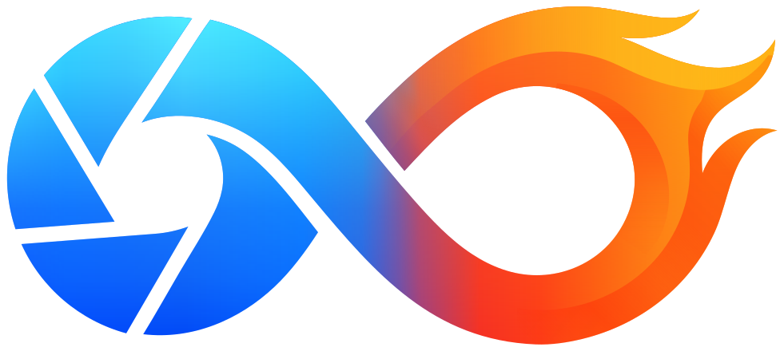

# MCRAWsome

MCRAWsome is an independent project. It is not affiliated with or endorsed by MotionCam.

Open-source tools for MotionCam Pro RAW video (`.mcraw`) and Direct Log video: inspect clips, prepare
them for DaVinci Resolve and other software, and export CinemaDNG and OpenEXR folders or trimmed and
repaired MCRAW copies, with aligned audio. MCRAWsome does not encode video. An interrupted export
picks up where it stopped. Linux first.

## Desktop interface

For a packaged release on Debian 13, install its `.deb` with
`sudo apt install ./mcrawsome_VERSION_amd64.deb`, which adds the application menu entry, the
`.mcraw` file type and its thumbnails in file managers (the first frame). It uses Debian's own Python, FFmpeg, WebKitGTK and other packages, and carries only
the Python packages Debian lacks; `packaging/deb/README.md` explains the build. On other Linux
systems (glibc 2.39 or later: Ubuntu 24.04, Linux Mint 22, Fedora 40, Arch and later), run the release's
`mcrawsome-VERSION-x86_64.AppImage`, which carries its own Python, decoding FFmpeg and window libraries;
`packaging/appimage/README.md` explains it. From a source install,
run `mcrawsome gui` (or `uv run mcrawsome gui` in this checkout). The [user guide](docs/user-guide.md)
covers Library previews, Resolve Settings and native Resolve archives. RAW cards offer a Mount/Unmount
toggle and Send to Resolve for Media Bin or Timeline imports, with optional gyro corrections.
**About** shows versions and licences.

## Install (development)

    uv sync
    uv run mcrawsome --help

FFmpeg (`ffmpeg` and `ffprobe` on your PATH) is needed only for Direct Log recordings, which it decodes
and probes: H.265, ProRes-compatible and AV1. RAW (`.mcraw`) clips do not need it.

    mcrawsome doctor

checks FFmpeg and its decoders, GPU decoding (VAAPI or NVIDIA), memory, disk space, the CPU temperature
sensor and your settings. It exits 1 only when a check fails; a warning means something optional is
missing.

## Usage

    mcrawsome info clip.mcraw
    mcrawsome analyse clip.mcraw                       # exposure, clipping, white balance and motion
    mcrawsome export clip.mcraw                        # a CinemaDNG folder, audio aligned
    mcrawsome export clip.mcraw --to exr               # scene-linear OpenEXR frames
    mcrawsome export clip.mcraw --start 0:12 --duration 5s
    mcrawsome export *.mcraw --output exports/ --recipe my-settings.toml
    mcrawsome export clip.mcraw --dry-run              # show the resolved Recipe only
    mcrawsome export --help-all                        # every Recipe setting, its values and default
    mcrawsome copy /media/card/DCIM ~/Videos/MotionCam  # offload recordings, verified

Settings can also live in `~/.config/mcrawsome/defaults.toml` (your defaults) and `mcrawsome.toml`
next to the clips (per folder). Command-line options override both. Recipes saved by earlier versions
still load: their look, effect, noise reduction and video encoding settings are ignored, and a Recipe
that asks for a video format says that MCRAWsome no longer encodes video.

Every export writes a `.mcrawsome.toml` sidecar beside the output: the MCRAWsome version, a hash of the
input's first 16 MiB, the full Recipe and what was measured and decided (exposure, clipping, frame
rate and dropped frames).

## Outputs

`--to` chooses what to make (`--output.kind` in a Recipe):

| `--to` | What it holds | Files |
|---|---|---|
| `dng` (default) | CinemaDNG: the sensor data, full size or as proxies | a folder of DNGs and a WAV |
| `exr` | OpenEXR: scene linear in ACEScg or Linear Rec.709, half float | a folder of EXRs and a WAV |
| `mcraw` | a trimmed or repaired MotionCam RAW file | `.mcraw` and its `.gcsv` |

To edit or grade in DaVinci Resolve without exporting anything, send clips to Resolve from the
interface: they are mounted as virtual CinemaDNG sequences (Linux FUSE 3) and imported into the Media
Pool or a timeline.

## Analysis and trimmed exports

    mcrawsome analyse clip.mcraw
    mcrawsome export clip.mcraw --start 5s --duration 3s

`analyse` measures a sample of frames and reports, in plain language, the automatic exposure and the
scene's brightness, clipped highlights, noise, whether the white balance drifts, how bright the picture
is on a display, and how much the gyro could stabilise. It suggests what to change and renders nothing.
Times are seconds (`5`, `5s`), minutes and seconds (`1:05`) or frames (`120f`). `--start` and
`--duration` export part of a clip, with the audio aligned to its first frame.

## Exposure, highlights and lens shading

    mcrawsome export clip.mcraw --to exr                                  # automatic exposure
    mcrawsome export clip.mcraw --to exr --develop.exposure 1.5           # exactly +1.5 stops
    mcrawsome export clip.mcraw --to exr --develop.highlight_recovery 0   # no highlight rebuilding
    mcrawsome export clip.mcraw --to exr --develop.lens_shading 0.5       # keep some of the vignette

Exposure is automatic by default: MCRAWsome brings the scene's average brightness (its log-average,
ignoring the brightest 2% such as lamps) to a set level. Phone clips are often one to two stops under;
the export notes the value it used, and a number always means exactly that number. OpenEXR frames
carry the exposure; CinemaDNG stores it as BaselineExposure and keeps the sensor values. Highlight
recovery rebuilds colour where one or two of a pixel's channels hit sensor white, from the surviving
channels and the colour just outside the clipped area, instead of turning it grey; areas clipped in
every channel still go smoothly to white. It needs RAW input. `--develop.lens_shading` sets how much
of the lens's vignette is corrected (1 all of it, 0 none).

## Direct Log videos

    mcrawsome export 261011_095029_VIDEO_25mm_Davinci_Davinci-WG.mp4 --to exr

MotionCam's Direct Log mode records ordinary video files with a log encoding (H.265, ProRes-compatible
or AV1). MCRAWsome previews them and exports them as OpenEXR; CinemaDNG and MCRAW need RAW frames, so
they are not available for them. Rotated recordings (a rotation tag, for example portrait clips) are
turned the way a player turns them.

Record with **DaVinci Wide Gamut / DaVinci Intermediate**: it keeps the most highlight detail. BT.709 recordings work too, but their highlights are clipped by the
phone before MCRAWsome sees them. MotionCam writes the same colour tags whatever is chosen, so the
encoding is read from the file name (`_Davinci_Davinci-WG`, `_BT.709_BT709`); for a renamed file set
it by hand with `--develop.input_encoding davinci` (or `bt709`, `acescct`). The gyro is recorded
inside the file (there is no `.gcsv` in this mode), and `mcrawsome info` shows what the file holds.

Variable-rate LOG is supported. The app reads presentation timestamps without decoding the whole
recording and maps them onto a fixed-rate preview and export clock, repeating or skipping pictures while
keeping audio at its recorded speed. Keep uses the nominal rate for VFR; Resolve Settings' Frame rate control
or `--output.frame_rate 25` chooses another rate. No converted copy is needed for preview. Export
creates fixed-rate media for editing in Resolve. Changing Resolve's clip-rate attribute alone changes
video speed without resampling its timestamps, so it is not a substitute for this conversion.

MotionCam's Full Range option uses the complete numeric range, for example 0 to 1023 at 10-bit, rather
than video-range luma's 64 to 940. The decoder respects the recorded range flag automatically; no extra
range switch is needed for correctly tagged recordings. Range is independent of the LOG transfer curve
and gamut. When importing an original directly into Resolve, check Clip Attributes > Data Levels if
Auto misinterprets it, and choose Full for a full-range recording. The Info tab shows signal range,
frame timing, camera/lens facts and available gyro/accelerometer telemetry. Unrecorded ISO, shutter or
white balance values remain unavailable.

Video import requires an embedded declaration of a recognised Log transfer or recording profile.
MP4, MOV and MKV containers are probed independently of codec and bit depth. BT.709/sRGB, PQ, HLG,
linear and unidentified video are excluded. Filename tokens, wide gamut, 10/12-bit encoding and gyro
telemetry alone do not establish Log. Some cameras omit proprietary Log metadata from the fields
FFprobe exposes; those files cannot currently be identified safely and are rejected with an explanation.
A recognised Log profile does not guarantee an available automatic colour transform.

## Gyro and stabilisation

Exports are not stabilised: CinemaDNG and OpenEXR are for other software, which stabilises them itself.
The gyro is used where it helps that software: Send to Resolve can add gyro corrections, and
`mcrawsome gyro` fits the sync for Gyroflow. MCRAWsome uses the gyro log (the `.gcsv` MotionCam writes next
to a RAW clip, or the telemetry inside a Direct Log video), fits its timing, axes and focal length to the
picture, and plans the correction of rotation and the rolling shutter's skew row band by row band.

The gyro measures the phone's body only. The phone's optical image stabilisation (OIS) also moves the
lens, and the recording does not describe that movement, so MCRAWsome cannot account for it; this may
limit how much shake is removed on cameras with OIS.

To see what the gyro fit finds, without rendering:

    mcrawsome gyro clip.mcraw

This prints the sync offset, the axis mapping, the focal length, the readout, the confidence (and the
reason when it is too low), the size of the correction, how many frames needed gentler smoothing and
the gyro coverage.

## Camera profiles and calibration

A camera profile records what is known about a camera: focal length, rolling-shutter readout, gyro
axes and the usual sync offset. It makes the fit faster and more robust. MCRAWsome includes one for
the Pixel 10 Pro XL at 3840x2160; your own go in `~/.config/mcrawsome/cameras/` as TOML files and win
over the built-in ones.

    mcrawsome calibrate calibration.mcraw              # print the profile, save nothing
    mcrawsome calibrate calibration.mcraw --save --name my_phone_main_4k
    mcrawsome calibrate clip.mcraw --from-gyroflow lens.json --save

For a calibration recording, film a static, distant, detailed scene with slow pans, tilts and rolls
in every direction for 30 to 60 seconds. MCRAWsome measures every frame, fits with the widest search
and measures the readout from the top and bottom thirds of the frame. It will not save a profile it
does not trust. `--from-gyroflow` takes the focal length and readout from a Gyroflow lens profile
(Gyroflow's lens profile database covers many phones), and retains measured OpenCV standard or
fisheye lens geometry in the saved camera profile. Existing gyro axes, sync and gravity mappings
are kept when replacing a matching profile. Lens correction is not yet applied to MCRAWsome's image
pixels. The checkerboard recording used to measure a lens is different from the distant-scene gyro
calibration above; record it with the same lens, resolution and sensor crop as the footage.
See [CONTRIBUTING.md](CONTRIBUTING.md) to send a profile in.

## Gyroflow

    mcrawsome gyro clip.mcraw --gyroflow for-gyroflow/

Writes a Gyroflow lens profile (`clip_lens.json`: measured lens geometry when imported, otherwise
an uncalibrated pinhole, plus readout, frame size and rate) and, for RAW clips with a trusted sync,
`clip_synced.gcsv`: the gyro log shifted so that
time zero is the first frame. Load the exported frames in Gyroflow with both files to stabilise them
there.
Direct Log videos already carry their gyro, so only the lens profile is written for them.
Measured geometry can be uniformly resized for another resolution of the same shape. A changed
aspect ratio needs a known sensor crop mapping, so export refuses it rather than guessing. Digital
lens transforms and interpolated calibrations are not supported. Importing a lens does not establish
that it matches the phone, camera module or recording mode; choose a calibration for the actual lens.

## CinemaDNG

    mcrawsome export clip.mcraw --to dng --output exports/

Writes `exports/clip_DNG/` with one DNG per frame (the sensor values as recorded, with the camera's
colour matrices and lens shading as standard gain maps) and the audio as a WAV that starts with the
first frame. The Recipe's exposure is stored as BaselineExposure.

    mcrawsome export clip.mcraw --to dng --output.dng_compression lossless

writes lossless JPEG DNGs (the compression cameras use for CinemaDNG), about a third of the size and
with exactly the same sensor values. It is not the default yet: it has been checked with LibRaw and
RawTherapee, and will become the default once checked in DaVinci Resolve.

    mcrawsome export clip.mcraw --to dng --output.dng_scale half

writes half-width, half-height proxies to `clip_DNG_half/`: each 2x2 block of same-colour sensor sites
becomes one site (their mean), so the files are still raw mosaics with the same colour data, at about a
quarter of the size. A frame size that is not a multiple of 4 is cropped to one, with a note.

    mcrawsome export clip.mcraw --to dng --develop.deflicker 1 --output.dng_deflicker baked

measures every frame's brightness and evens out flicker and exposure steps (misbehaving auto exposure,
holy-grail timelapses) towards the average over `--develop.deflicker_seconds` (1 by default). By default
each frame's correction is stored as its BaselineExposure and the raw values are untouched; `baked`
scales the raw values instead, for editors that ignore BaselineExposure, with up to two stops of
headroom (the white level rises; a frame brightened further clips). The values are the ones a mount
with picture exposure normalisation serves.

## OpenEXR

    mcrawsome export clip.mcraw --to exr --output exports/

Writes `exports/clip_EXR/` with one half-float OpenEXR per frame, in scene linear after the exposure:
ACEScg (AP1) by default, or Linear Rec.709 with `--output.exr_space linear-rec709`. Compression is
lossless ZIP, or PIZ with `--output.exr_compression piz`. The audio is a WAV that starts with the first
frame. Direct Log videos are converted from their log encoding.

## Copying recordings from a card or phone

    mcrawsome copy /media/card/DCIM ~/Videos/MotionCam

copies every MotionCam recording found in the folder and its subfolders (or the `.mcraw` files named),
each with its split parts (`NAME.0.mcraw`, `NAME.1.mcraw` ...) and the files named after it (`.gcsv`
gyro data, `.json`, `.mcrawsome.toml`), with progress and speed. Each file is hashed (SHA-256) as it is
copied, synced, read back from the disk and compared before it takes its name, so the card can be
cleared afterwards. Files already copied are skipped and a different file of the same name is never
replaced (the command reports it and exits 1). A copy stopped part-way leaves a `.part` file; copying
again keeps the blocks of it that match the source and carries on. `--no-verify` skips the read-back;
`--json` lists every file's result and hash. Verified offloading is available through this command; the desktop interface has no Copy from Card control.

## MCRAW copies

    mcrawsome export clip.mcraw --to mcraw --start 0:12 --duration 5s   # clip_288-407.mcraw
    mcrawsome export clip.mcraw --to mcraw                              # clip_repaired.mcraw

Copies the recorded frames into a new `.mcraw` without changing them (lossless and fast), with their
metadata, the sound that overlaps them, a complete frame index and the matching `.gcsv` rows beside it.
Use it to cut a long recording down, or to give a recording that was not finalised its index back.
Exposure and the other picture settings do not apply (a note says so when they are set).
`--start` and `--duration` count recorded frames here. Direct Log videos are refused.

## Recovered clips and dropped frames

A recording that was not finalised (the phone stopped or the app was closed) has no frame index at the
end. MCRAWsome reads such a clip by scanning it from the start: `mcrawsome info` and every export say
"Recovered: the recording was not finalised; N frames were found by scanning", and a frame cut short
at the end is left out. `--to mcraw` writes a repaired copy.

When the phone drops frames, the sound keeps going. MCRAWsome repeats the frame before each gap once
for each missing frame, so the picture stays in sync with the sound; the export notes where
("filled 3 dropped frames (at 4.2 s, 9.0 s, 9.1 s)") and the sidecar lists them.
`--output.fill_dropped false` keeps only the recorded frames. CinemaDNG and OpenEXR folders get one
file per output frame, so they line up with the sound.

## Long exports: resuming and the CPU temperature

    mcrawsome export clip.mcraw                       # interrupted? run the same command again
    mcrawsome export clip.mcraw --restart             # start an interrupted export again instead

Exports are written in a hidden work folder beside the output (`.NAME.mcrawsome-work`). If an export
is interrupted (Ctrl+C, a crash, a full disk, a power cut), the same command resumes it, keeping the
frames already finished, and says so; if the settings have changed, it starts again and says why. Nothing partial is ever left at the output path, and there is nothing to
clean up by hand: the work folder is removed when the output is published.

    mcrawsome export clip.mcraw --thermal-limit 85

`--thermal-limit` (60 to 105 °C, on `export`) keeps a long render from running
the CPU hot: before each piece of work it waits while the CPU package is at or above the limit, until
it has cooled by 10 degrees, and the export notes how often and how long it paused. The output is the
same as without the limit. It reads Intel's and AMD's package sensors; without one it has no effect and
says so.

## The local media server

    mcrawsome server --library ~/Videos/motioncam

The engine serves libraries, previews, clip settings, analysis and Resolve mounts at
`http://127.0.0.1:8642/api/v1`. It has no export queue or automatic hot-folder exports.
Its OpenAPI document is `/api/v1/openapi.json`; `/events` carries library, analysis and
media-use changes, and the stages of Resolve sends. It listens locally by default. Listening on another address requires
`--token`; traffic needs a private network or HTTPS reverse proxy.

## Scripting: `--json`, error codes and `--help-all`

`info`, `analyse`, `export` and `doctor` take
`--json`: they print one JSON document and nothing else (no notes or progress bars). A command that
fails prints `{"error": {"code": ..., "message": ...}}` and exits 1; `export` lists each clip's result,
with its own `error` when that clip failed, and exits 1 if any did. The codes are stable, so scripts,
the CLI and the API can tell failures apart: `input-missing`, `input-unreadable`, `recipe-invalid`,
`output-exists`, `output-unwritable`, `tool-missing`, `encoder-unavailable`, `measure-failed`,
`stabilise-failed`, `render-failed`, `encode-failed`, `verify-failed`, `disk-full`, `paused`,
`cancelled`, `path-not-allowed`, `host-not-allowed`, `origin-not-allowed`, `unauthorised`
and `internal-error`.

`export` and `analyse` take `--help-all`, which lists every Recipe setting with its type,
allowed values and default.

## Bug reports

    mcrawsome support-bundle clip.mcraw exports/clip_DNG.mcrawsome.toml

writes `mcrawsome-support-YYYYmmdd-HHMMSS.zip` (or `--output FILE`) with what a bug report needs:
doctor's checks, a description of the system (operating system, processor, memory, Python, the versions
of MCRAWsome's dependencies and `ffmpeg -version`), the sidecars and Recipe files given, and the metadata of the clips given. It holds no
picture, sound, gyro samples or recording location, and your home folder is written as `~`; file and
folder names are kept, so look through it before sharing. Its `README.txt` lists every member.

## Contributing

Code changes must pass `./gates.sh`: Ruff, strict mypy, pytest with warnings treated as errors, and
the interface's svelte-check and Vitest tests when Node is installed.
See [CONTRIBUTING.md](CONTRIBUTING.md) for camera profiles.

Fetch the approved real-clip fixtures with:

    uv run python scripts/fixtures.py fetch
    uv run pytest -m "not local and not gpu"

The manifest in `tests/fixtures/manifest.toml` lists the download URL, SHA-256 and filenames.
`MCRAWSOME_FIXTURES_URL` overrides the URL. For a private GitHub release asset, set the URL to
`https://api.github.com/repos/OWNER/REPO/releases/assets/ID` and supply `MCRAWSOME_FIXTURES_TOKEN`.
The fetcher checks the hash before writing files and refuses unsafe archive members. An empty URL
skips the download successfully; tests whose fixtures are missing skip too. CI caches the fixture
folder by the manifest's hash and uses its read-only `GITHUB_TOKEN` to fetch private assets.
12-bit fixture tests skip until a 12-bit recording is approved.

To build the archive, run this from a scratch folder outside the repository, using the project's
Python environment (replace `REPO` with the checkout's absolute path):

    REPO/.venv/bin/python REPO/scripts/fixtures.py build ~/Downloads/motioncam

This trims three frames from the approved `261004_174122_VIDEO_26mm` recording, copies its gyro log,
and writes `mcstudio-fixtures-v1.tar.gz` in the current folder. It prints the archive's size and hash
and updates the manifest with an empty URL. The owner uploads the archive as a release asset and
then fills in the URL. Keep the archive and `tests/fixtures/data/` out of Git.
`scripts/make_fixtures.py SOURCE_DIR` creates the approved fixtures and also the local-only 12-bit clip
(`LOCAL_ONLY` in that script), which is never packed, committed or uploaded.

## What the recording's data tells you

Without decoding pictures, MCRAWsome reads every frame's metadata, the gyro log and the sound:

- **Search** matches file names and each clip's title, description, keywords, notes, scene, shot,
  take, location and camera label.
- **Movement** (Still, Pan or tilt, Moving, Handheld) and **shake blur** in pixels come from the gyro
  log; blur from an intended pan is not counted. Library filters, Info, Analytics and the preview
  overlay show them; thumbnails show the steadiest frame.
- **Suggest trim** sets In and Out past the jolts of pressing record and stop, and after focus
  settles; **Suggest trims** does so for a selection, keeping marks clips already have.
- **Readiness** explains capture problems: a frame rate lowered by a long shutter, automatic exposure
  or white balance, focus hunting, and clipped, very quiet, silent or duplicated sound.
- **Places, shoots and recordings made together**: the nearest city to a GPS fix (offline, from
  Debian's GNOME location data), shoots split by two-hour gaps or 5 km moves, and clips whose
  recordings overlap (from different phones). Sessions can start from a shoot.
- **Lists**: a camera report of the selected clips as CSV or Avid ALE, and their positions as GPX.
- **Time-of-day timecode** (Settings > DaVinci Resolve > Timecode): mounted DNGs and WAVs start at
  the time each clip was recorded on the phone's clock, in this computer's or the recording location's
  time zone, so Resolve can sync several phones or an audio recorder by timecode. Exports take
  `--output.timecode time-of-day`. Clips sent to Resolve show those times as their Start TC and End
  TC, in bins and on timelines.
- **Measured keywords** (optional) add the movement to the keywords Resolve receives.

`GET /api/v1/clips/{id}/motion` and `/checks` report the movement, blur, suggested trim and capture
warnings; `POST /api/v1/clips/report` makes the lists.

## Sessions

Open Clips is also the session workspace. Session files store the original recording paths, selection
and library filters. They do not depend on active mounts. Missing originals remain referenced so an
unplugged drive can be reconnected later. Save with relative paths stores paths relative to the session
file; it does not copy media. Move the session and recordings together with their folder layout intact.

Saved sessions include the original recording paths and each clip's complete settings: trim marks,
orientation, Resolve settings, notes and production details, overlay selection and Adaptive/Source
preview mode. Loading a session restores those choices independently of current folder defaults.
Missing originals retain their saved settings until reconnected. Older reference-only sessions
still open.

Editable clip details save beside recordings as `.meta` files containing JSON, with only non-default
fields. Clearing all details removes the adjacent sidecar. Read-only folders use local state.
Existing `.json` sidecars are not renamed or migrated by the application.

## Sending to DaVinci Resolve

Timeline sends fit each video's displayed mounted resolution within 3840×2160 by default, preserving
its proportions with even-pixel rounding and the full mounted media. Select DaVinci Resolve Studio
in Settings to retain dimensions above that limit. Free is the default; an icon beside oversized
clip resolutions explains the timeline limit.

A Resolve timeline takes only whole frame rates up to 60 fps, so a timeline send checks each clip's
rate before mounting anything. A clip at another rate (a recording at 23.792 fps, say) is named in a
**Frame rates for the timeline** panel, which offers to set its Mounted frame rate to the nearest whole
rate and send; Cancel changes nothing. A selection with different frame rates or resolutions produces
one timeline for each, keeping clip order within each.

Resolve Location includes recorded GPS coordinates: `Location from Notes (latitude, longitude)`, or
coordinates alone if no location was entered. GPS altitude/time stay in Camera Notes. Capture fields
show nearby nominal camera FPS, shutter angle and fractional shutter speed; Camera Notes retain
precise recorded exposure and measured FPS. For example, a recorded 24.001545 fps and 20.825846 ms
exposure display as 24 fps, 180 degrees and 1/48. This changes descriptive metadata on new sends and
does not alter source timing or pixel data.

Review markers are optional in Resolve Settings and apply to timeline sends. They flag frequent focus
changes, recording gaps, severe shake, Recorded tilt and Remaining tilt after the actual corrections.
Tilt needs calibrated gravity axes and uses a 5-degree threshold sustained for about a second, with
3-degree release hysteresis. Focus changes and tilted compositions can be intentional.
Marker colours distinguish categories: purple focus, pink recorded tilt, cyan remaining tilt, yellow
highlight clipping, blue low signal, red shake, sand recording gaps and green motion blur (sustained
shake blur from the gyro log and shutter, which stabilisation cannot remove).
Highlight clipping and Low recorded signal use up to 120 evenly spaced RAW frame samples. These
point markers identify sampled evidence only; short events between samples can be missed. Unavailable
or unreliable sensor measurements are omitted. DNG frame names end in `-000000.dng`.
All eight categories start on and can be turned off one by one with marker-coloured switches.
Shake suggestions need strong, sustained sensor motion. Remaining tilt is available only with
Stabilise on and is only emitted when a correction plan was applied.

On Debian, media mounted for Resolve stays open through an MCRAWsome upgrade: each mount's own user
service keeps the application code it started with, and the new engine takes it over. Close Resolve
before uninstalling.
